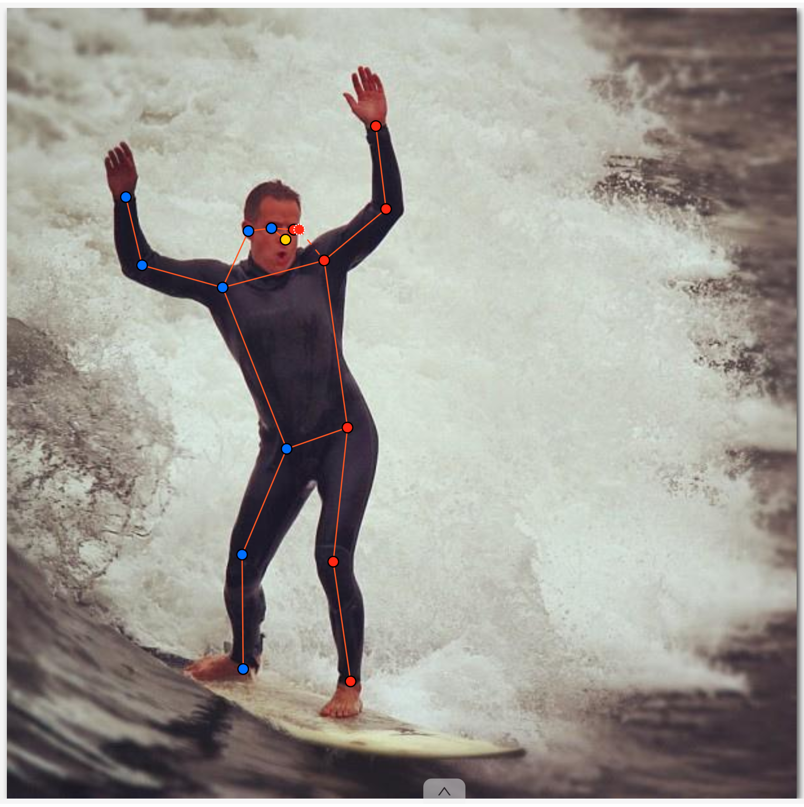
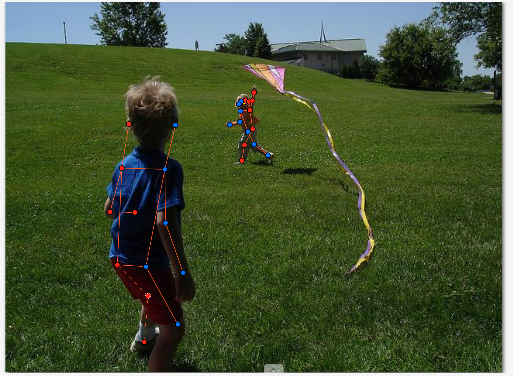
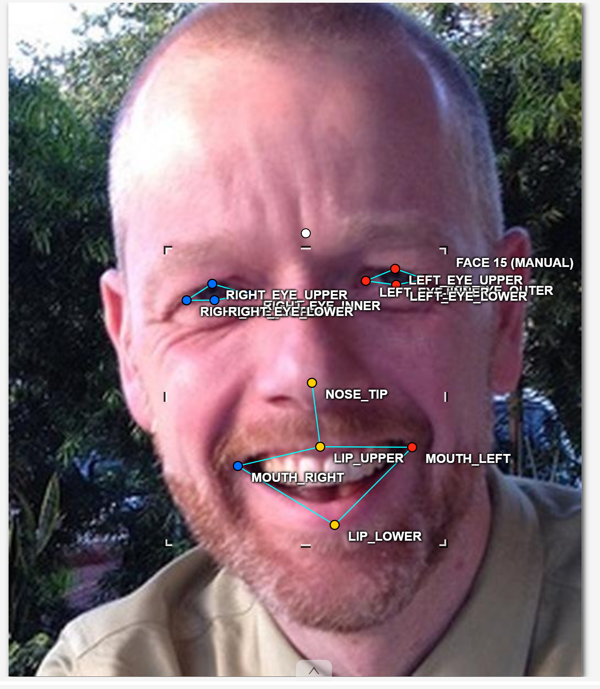
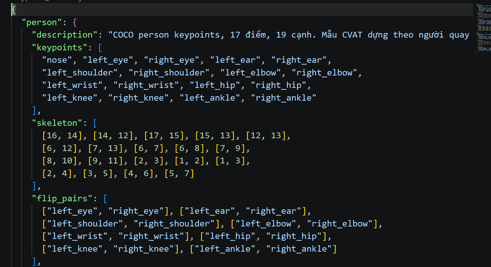

# Báo cáo cá nhân — 2A202603168_NguyenDangKhoa

Đổi tên file theo quy tắc `MSSV_HoTen.md`. Ví dụ: `20241234_NguyenVanAn.md`.

Dữ liệu: 12 ảnh người COCO val2017 (Lin et al., 2014) và 8 ảnh chân dung Wikimedia Commons, chỉ dùng trong lớp.

## 0. Thông tin học viên

- Họ tên: Nguyễn Đăng Khoa
- MSSV: 2A202603168
- Email: khoabeoloidom@gmail.com
- Link repository: https://github.com/NguyenKhoa1290/K5-L2A-DAY04-NguyenDangKhoa-03168-KeypointPose
- Phiên bản CVAT (Help → About): 
- Máy: hệ điều hành Windows 11 · RAM 32 GB · chạy CVAT chế độ đầy đ
- Bộ ảnh (`src/exports/assignment.json` do `lab.py setup` tạo): có
- Giờ bắt đầu: 16h 
- Giờ kết thúc: 22h

## 1. Kiểm tra label (CP0)

| Label | Kiểu | Số điểm | Tên điểm đúng bảng của lab? | Đúng thứ tự? | Số cạnh |
|---|---|---:|---|---|---:|
| `person` | hình người | 17 | Đúng |Đúng | 17 |
| `face` | hình mặt | 13 | Đúng | Đúng | 13 |

Mẫu `person` dựng theo người quay mặt về camera (các điểm `left_*` nằm bên phải khung mẫu)? Có / Không

Cách đổi cờ `occluded` / `outside` cho **một điểm** trên phiên bản CVAT này (một câu):

...

## 2. Số lượng đã gán và thời gian (CP1, CP2)

| Nhóm ảnh | Số ảnh | Số skeleton đã gán | Số người dưới 60 px (không gán) | Số poster / gương / màn hình bỏ qua | Thời gian (phút) |
|---|---:|---:|---:|---:|---:|
|  `person`|  12| 18| 1| 0| 30|
| `faces` | 8 | 8|  0| 0| 30|

- Số ảnh người đã xong ở mốc phút 105: 12 / 112
- Thời gian thực tế (phút): CP1 ___ · CP2 ___ · CP3 ___
- Ảnh tốn thời gian nhất là ảnh nào, vì sao?
-000000393909.jpg , ảnh 2 người rối, khó đánh
## 3. Bảng ca khó (CP1, CP2)

Mỗi điểm bạn phân vân một dòng, nhất là phân vân giữa `v = 1` và `v = 0`, hoặc không chắc hướng người.

| Ảnh | Người / mặt | Điểm | Cờ đã chọn | Phân vân giữa | Lý do chọn |
|---|---|---|---:|---|---|
| 0000000018804.jpg | người | Vai phải người đàn ông | 1 | 0 | Thấy vai trái nhưng ko thấy chu vi hình thể, dự đoán mơ hồ |
| 000000393909.jpg | người | có nên đánh người bên trái hay không | có |không | Thấy đầu và chân, nhưng 50 % không thấy và có vật chê |
| face_137371.jpg | mặt | Đánh khóe mắt trong ảnh mờ | đánh dự đoán | | |

## 5. Kiểm file xuất và kết quả tự kiểm (CP4)

Tự kiểm tay trong file JSON:

| File | Người / mặt kiểm (ảnh, thứ tự) | Số phần tử `keypoints` | Điểm `outside` ra `v = 0`, `occluded` ra `v = 1`? | `num_keypoints` khớp? |
|---|---|---:|---|---|
| `NguyenDangKhoa_persons.zip` | `000000100510.jpg` #1 | 51 | Có: `v=0` có 7 điểm, `v=1` có 1 điểm | Có: 10 điểm `v>0` |
| `NguyenDangKhoa_persons.zip` | `000000188804.jpg` #1 | 51 | Có: `v=0` có 3 điểm, `v=1` có 3 điểm | Có: 14 điểm `v>0` |
| `NguyenDangKhoa_faces.zip` | `face_309728.jpg` #1 | 39 | `v=1` có 8 điểm; mẫu này không có điểm `v=0` | Có: 13 điểm `v>0` |

Trong các mẫu đã kiểm, `occluded` tương ứng `v = 1` và `outside` tương ứng `v = 0`. Tọa độ của điểm `outside` trong file là tọa độ cũ (CVAT 2.x); ví dụ `left_eye` trong `000000100510.jpg` có `v = 0` và tọa độ `[207.42, 46.71]`.

Hai job đã chuyển sang completed trên CVAT? Có (theo xác nhận của học viên)

Dán phần **TÓM TẮT** in ra từ `src/check_submission.py`:

```text
----- TÓM TẮT -----
- File person: NguyenDangKhoa_persons.zip
  Số ảnh: 12 · số skeleton `person`: 18 · mỗi annotation 51 số
  Skeleton theo ảnh: 000000100510=1, 000000103970=1, 000000176000=1, 000000188804=2, 000000205650=1, 000000240340=1, 000000307757=2, 000000360811=2, 000000393909=2, 000000433787=1, 000000461002=2, 000000522889=2
  Cờ v: v=2 220 (72%) · v=1 32 (10%) · v=0 54 (18%)
  num_keypoints trung bình: 14.0
- File face: NguyenDangKhoa_faces.zip
  Số ảnh: 8 · số skeleton `face`: 8 · mỗi annotation 39 số
  Skeleton theo ảnh: face_137371=1, face_145751=1, face_232598=1, face_249336=1, face_257657=1, face_309728=1, face_53580=1, face_560526=1
  Cờ v: v=2 86 (83%) · v=1 10 (10%) · v=0 8 (8%)
  num_keypoints trung bình: 12.0
- Ghi chú: 62 điểm v = 0 vẫn mang tọa độ cũ (CVAT 2.x xuất như vậy; chuẩn COCO ghi 0, 0). Không phải lỗi: điểm v = 0 bị bỏ qua khi huấn luyện và khi chấm.
- Số [LỖI]: 0 · số [CẢNH BÁO]: 5
Kết quả: ĐẠT (đọc lại từng cảnh báo ở trên)
```

Kết quả tự kiểm: **ĐẠT**, không có `[LỖI]`, có 5 `[CẢNH BÁO]`. Cần mở lại các ảnh tương ứng trên CVAT để xác nhận là `lr_swap` hay tư thế tay/chân bắt chéo thật; chưa ghi lý do giữ nguyên vì log tự kiểm không xác định được nguyên nhân:

- `000000188804.jpg` #1: cặp ankle nằm ngược phía so với các cặp còn lại.
- `000000240340.jpg` #1: cặp ankle nằm ngược phía so với các cặp còn lại.
- `000000393909.jpg` #1: cặp ankle nằm ngược phía so với các cặp còn lại.
- `000000461002.jpg` #2: cặp knee, ankle nằm ngược phía so với các cặp còn lại.
- `000000522889.jpg` #1: cặp wrist, ankle nằm ngược phía so với các cặp còn lại.

Đã finish và export, đã có 2 file .zip

## 6. Ảnh chụp màn hình

1. Label `person` trong label constructor (đủ 17 điểm có tên):

   

2. Một người quay lưng đã gán, cờ đã đặt:

   

3. Một khuôn mặt đã gán 13 điểm, phóng to vùng mắt:

   

4. Một đoạn JSON xuất của một người:

   

Nguồn ảnh: COCO val2017 / Wikimedia Commons.

## 7. Tự đánh giá

1. Lỗi bạn mắc nhiều nhất hôm nay, và cách bạn sẽ tránh ở dự án thật:

   Đánh dự đoán nhiều, lẫn lộn bên trái và phải

2. Một quy tắc bạn đề xuất thêm vào guideline (kèm ảnh ví dụ nếu có):


3. Nhãn của bạn đi vào model ở đâu? Chọn một lỗi bạn đã sửa và nói nó sẽ làm model học sai thế nào (heatmap, trọng số trong loss, hay bước lật ảnh):

   Đã sửa việc học lộn bên, khiên s mô hình học bị loạn

## 8. Khó khăn và lỗi kỹ thuật

...

## Bonus (nếu làm)

### B1 — 3 ảnh người khó thêm

| Ảnh | Số skeleton | Số người dưới 60 px | Ca khó nhất |
|---|---:|---:|---|
| | | | |
| | | | |
| | | | |

Kết quả `src/check_submission.py` cho `HoVaTen_bonus_persons.zip`:

```text
(dán ở đây)
```

### B2 — 5 ảnh khuôn mặt đen trắng / hồng ngoại

Ảnh không màu khó hơn ở điểm nào? Kính râm trên ảnh hồng ngoại có còn là `v = 1` không?

...

### B3 — Model so với nhãn của tôi (không tính điểm)

- Demo đã dùng:
- Ảnh đã thử:

1. Model có trả điểm cho khớp bị che, hay khớp ngoài ảnh không? Confidence ở các điểm đó thế nào?

   ...

2. Với người quay lưng, model có đổi trái/phải không?

   ...

3. Bộ điểm của model có giống 17 điểm COCO không?

   ...

## 9. Tài liệu tham khảo và công cụ AI đã dùng

Trợ lý AI chat (Copilot): hướng dẫn khắc phục CVAT và ghi kết quả tự kiểm mục 5 từ log `lab.py export`; không dùng AI để tạo keypoint hoặc nhãn.
